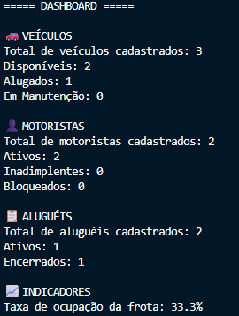
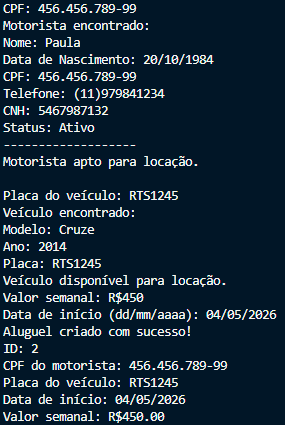
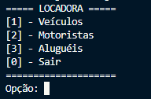

## 🚗 Projeto Locadora

Sistema de gerenciamento para uma locadora de veículos desenvolvido em Python.

O projeto permite o controle de veículos, motoristas e aluguéis, oferecendo funcionalidades de cadastro, consulta, atualização, exclusão, persistência de dados em JSON, relatórios gerenciais e dashboard com indicadores operacionais.

## 🎯 Objetivo do Projeto
Este projeto está sendo desenvolvido como parte da minha jornada de estudos em Python, aplicando conceitos fundamentais da linguagem na construção de um sistema de gestão com regras de negócio reais.

## 📋 Funcionalidades
### 🚗 Gestão de Veículos
- Cadastrar veículos
- Buscar veículos por placa
- Listar veículos cadastrados
- Editar informações dos veículos
- Excluir veículos

**Controle de status:**
- Disponível
- Alugado
- Em manutenção

### 👤 Gestão de Motoristas
Cadastrar motoristas
Buscar motoristas por CPF
Listar motoristas cadastrados
Editar informações dos motoristas
Excluir motoristas
Controle de status:
 - Ativo
 - Inadimplente
 - Bloqueado

### 📄 Gestão de Aluguéis
Criar aluguéis
Buscar aluguéis por ID
Listar aluguéis cadastrados
Encerrar aluguéis
Atualização automática da disponibilidade dos veículos

## ✅ Validações de Negócio

O sistema possui regras para garantir a integridade das operações:

- Não permite excluir veículos que possuam aluguel ativo
- Não permite excluir motoristas inadimplentes
- Não permite excluir motoristas com aluguel ativo
- Não permite criar múltiplos aluguéis ativos para o mesmo motorista
- Não permite criar aluguel para motoristas bloqueados ou inadimplentes
- Não permite alugar veículos indisponíveis

## 💾 Persistência de Dados

Os dados são armazenados em arquivos JSON, permitindo que as informações permaneçam disponíveis mesmo após o encerramento da aplicação.

### Estrutura

```text
dados/
├── veiculos.json
├── motoristas.json
└── alugueis.json
```

## 📊 Relatórios

O sistema possui relatórios gerenciais para consulta rápida das informações cadastradas.

Veículos
- Veículos disponíveis
- Veículos alugados
Motoristas
- Motoristas ativos
- Motoristas inadimplentes
- Motoristas bloqueados
Aluguéis
- Aluguéis ativos
- Aluguéis encerrados

## 📈 Dashboard

O dashboard apresenta uma visão consolidada da locadora:

Veículos
- Total de veículos cadastrados
- Veículos disponíveis
- Veículos alugados
- Veículos em manutenção
Motoristas
- Total de motoristas cadastrados
- Motoristas ativos
- Motoristas inadimplentes
- Motoristas bloqueados
Aluguéis
- Total de aluguéis cadastrados
- Aluguéis ativos
- Aluguéis encerrados
Indicadores
- Taxa de ocupação da frota (%)

## 🛠️ Tecnologias Utilizadas
- Python 3
- JSON para persistência de dados
- Git
- GitHub

## 📂 Estrutura do Projeto

```text
ProjetoLocadora/
│
├── main.py
├── menus.py
├── veiculos.py
├── motoristas.py
├── alugueis.py
├── relatorios.py
├── persistencia.py
│
├── dados/
│   ├── veiculos.json
│   ├── motoristas.json
│   └── alugueis.json
│
└── README.md
```

## 🚀 Como Executar
 
Clone o repositório:
 
```bash
git clone https://github.com/OtavioMarianoCamargoDuarte/ProjetoLocadora.git
```
 
Acesse a pasta do projeto:
 
```bash
cd ProjetoLocadora
```
 
Execute o sistema:
 
```bash
python main.py
```
## 📌 Evolução do Projeto

### v1.0

- CRUD de veículos
- CRUD de motoristas
- CRUD de aluguéis
- Persistência em JSON

### v1.1

- Validações de integridade
- Relatórios gerenciais
- Melhorias nas regras de negócio

### v1.2 (Atual)

- Dashboard gerencial
- Indicadores operacionais
- Taxa de ocupação da frota

## 📸 Screenshots

### Dashboard Gerencial



### Criação de Aluguel



### Menu Principal



## 👨‍💻 Autor

**Otavio Mariano Camargo Duarte**

Desenvolvido como projeto de estudo para prática de Python, lógica de programação, manipulação de arquivos, modularização e versionamento com Git e GitHub.
